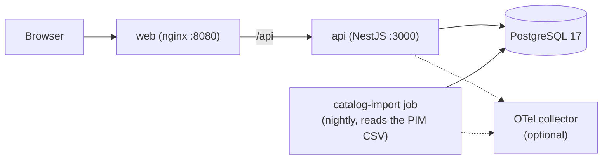
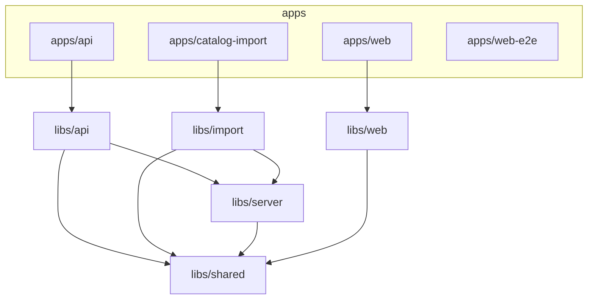

# Product Finder

A first version of the BASF Care Chemicals Product Finder. Customers search, filter and sort the catalogue on a phone or a desktop, share a link to exactly what they see, and read and write reviews. The catalogue comes from the nightly PIM export (`data/products.csv`).

I spent about 10 hours on it. I wanted to show how I generally approach a product like this. The choices are my own preferences: Nx and technologies I have used for years.

Stack: Angular 22 and PrimeNG 22, NestJS 11 (CommonJS), PostgreSQL 17 with Prisma 7, Jest 30, Nx 24, Docker Compose.

## Quick start

You need Docker with Compose v2. For local development you also need Node.js 24 and pnpm 9.9.0 (`corepack enable` once).

```bash
docker compose up --build        # everything: http://localhost:8080 (API docs: http://localhost:3000/api/docs)
pnpm install && pnpm run setup && pnpm dev   # local dev: web http://localhost:4200, API http://localhost:3000/api
pnpm check                       # prettier check, then lint, typecheck, test, build
```

- The Docker stack starts the database, runs `migrate` (migrations, the CSV import and 12 demo reviews), then the API and the web app. You see 199 products.
- Run the import again with `docker compose run --rm migrate`. It changes nothing on a second run, and reviews survive. Start from an empty database with `docker compose down -v`.
- `pnpm run setup` starts Postgres in Docker, copies `apps/api/.env.example` to `apps/api/.env`, applies the migrations and seeds. Use `pnpm run setup`: plain `pnpm setup` is a built-in pnpm command.
- If a port is taken, set `DB_PORT`, `API_PORT` or `WEB_PORT`, for example `WEB_PORT=8090 docker compose up --build`.
- Health: `/api/health/live` and `/api/health/ready`.

## Architecture

Runtime:



The collector exists only with `docker-compose.observability.yml`.

Code. An arrow means "may import". `shared` imports nothing.



| Path                  | Nx project       | Holds                                                                                                                                                                                                                       |
| --------------------- | ---------------- | --------------------------------------------------------------------------------------------------------------------------------------------------------------------------------------------------------------------------- |
| `apps/api`            | `api`            | NestJS 11 HTTP app                                                                                                                                                                                                          |
| `apps/catalog-import` | `catalog-import` | Own app and Docker image: `migrate`, `seed`, `import`, `status`                                                                                                                                                             |
| `apps/web`            | `web`            | Angular 22 shell, nginx config                                                                                                                                                                                              |
| `apps/web-e2e`        | `web-e2e`        | Playwright and axe browser tests                                                                                                                                                                                            |
| `libs/shared`         | `shared`         | Pure domain: SKU rule, limits, search, visibility                                                                                                                                                                           |
| `libs/server`         | `server`         | `src/db` (Prisma 7, the only code that touches Prisma), `src/ratings` (the only writer of `review_count`, `rating_sum`, `rating_avg`), `src/config` (zod env), `src/observability` (pino, probes, OpenTelemetry, 5 metrics) |
| `libs/api`            | `api-lib`        | `catalog/`, `reviews/`, `http/`                                                                                                                                                                                             |
| `libs/import`         | `import`         | `domain/` (pure pipeline and ports), `adapters/`                                                                                                                                                                            |
| `libs/web`            | `web-lib`        | `search/`, `product/`, `data-access/` (generated types and Angular client), `ui/`, `url-state/`                                                                                                                             |
| `tools/perf`          | `perf`           | 50,000-product generator and one bench command                                                                                                                                                                              |

ESLint (typescript-eslint strict, angular-eslint with a11y, Nx module boundaries, import-x, unused-imports) fails on a boundary break. Projects import each other only through `@product-finder/*` aliases. See the graph with `pnpm nx graph`.

The OpenAPI spec is generated, not committed. `pnpm nx run api:openapi` writes `dist/contracts/openapi.json`. `pnpm nx run web-lib:generate` makes the types and the Angular client (`@hey-api/openapi-ts`). `postinstall` runs the Prisma and client generation, so a fresh `pnpm install` is enough.

The reasons for the choices are in [DECISIONS.md](DECISIONS.md). How I used AI is in [AI_USAGE.md](AI_USAGE.md).

## Commands

Run them from the repo root.

| Command                            | What it does                                                            |
| ---------------------------------- | ----------------------------------------------------------------------- |
| `pnpm run setup`                   | Database in Docker, `apps/api/.env`, migrations, seed                   |
| `pnpm dev`                         | API and web app together, both reload on change                         |
| `pnpm db:up`                       | Only the database                                                       |
| `pnpm seed`                        | Import, plus demo reviews when `SEED_DEMO_REVIEWS=true`                 |
| `pnpm import:products`             | Import the PIM export (flags below)                                     |
| `pnpm lint`                        | ESLint                                                                  |
| `pnpm format`, `pnpm format:check` | Prettier: write, or only check                                          |
| `pnpm test`                        | Unit tests (Jest)                                                       |
| `pnpm test:e2e`                    | API and import e2e tests against the test database (needs `pnpm db:up`) |
| `pnpm check`                       | Prettier check, then lint, typecheck, test and build                    |

Browser tests: `apps/web-e2e` runs Playwright with axe on desktop Chrome, an Android phone and an iPhone against a running stack. Start the stack with a higher review limit, then run them:

```bash
pnpm exec playwright install --with-deps chromium webkit   # once
THROTTLE_WRITE_PER_MIN=50 docker compose up --build --wait
pnpm nx e2e web-e2e
```

## The import

The import is a CLI, not an HTTP endpoint (there is no auth). It is the app `apps/catalog-import` with four sub-commands: `migrate`, `import`, `seed` and `status`.

```bash
pnpm import:products                       # default file: CATALOG_FILE or data/products.csv
pnpm import:products --file path/to/export.csv
pnpm import:products --dry-run             # parse and plan, write nothing
pnpm import:products --force               # skip the truncated-file guard (below 50% of current products)
pnpm nx run catalog-import:status          # the last 10 runs as a table
```

It works on an empty database and is safe to run many times. It never deletes a product and never touches reviews or rating aggregates. Every run is logged in `import_run`. Only one import runs at a time. The data rules are in [DECISIONS.md](DECISIONS.md#4-how-the-csv-defects-are-handled).

| Exit code | Meaning                       | Alert                            |
| --------- | ----------------------------- | -------------------------------- |
| 0         | success or no-op              | no                               |
| 1         | failed (error, rolled back)   | yes                              |
| 2         | aborted by the 50% guard      | yes, the export is likely broken |
| 3         | another import holds the lock | no, unless it repeats            |
| 4         | bad arguments or config       | yes                              |

In production a nightly job runs the `catalog-import` image. Its default command is `node --require ./otel.js main.js import`. A scheduler should call that, not `pnpm`, because a failed `pnpm` script can show up as exit code 1. The job never runs `seed`, because demo reviews are fake.

## Configuration

Settings are environment variables. Locally they go in `apps/api/.env`. The API and the import read them once at start. A wrong value stops the start with one message that names the bad key and never prints the value.

| Variable                      | Default                     | What it does                                                                |
| ----------------------------- | --------------------------- | --------------------------------------------------------------------------- |
| `DATABASE_URL`                | required                    | PostgreSQL connection string                                                |
| `TEST_DATABASE_URL`           | local `product_finder_test` | e2e database, its name must end in `_test`                                  |
| `PORT`                        | `3000`                      | API port                                                                    |
| `CORS_ORIGIN`                 | `http://localhost:4200`     | Browser origin that may call the API                                        |
| `TRUST_PROXY`                 | `false`                     | Number of proxy hops. Set `1` behind nginx so rate limits see the client IP |
| `THROTTLE_READ_PER_MIN`       | `600`                       | Reads per minute per IP                                                     |
| `THROTTLE_WRITE_PER_MIN`      | `20`                        | Review posts per minute per IP                                              |
| `CATALOG_FILE`                | `data/products.csv`         | File the import reads without `--file`                                      |
| `SEED_DEMO_REVIEWS`           | `false`                     | `true` makes the seed add 12 demo reviews. Local use only                   |
| `LOG_LEVEL`                   | `info`                      | pino log level                                                              |
| `OTEL_EXPORTER_OTLP_ENDPOINT` | unset                       | OTLP/HTTP URL. Set, it turns on traces and metrics                          |

## Observability

The API and the import write JSON logs (pino) with request ids, and expose live and ready probes. With `OTEL_EXPORTER_OTLP_ENDPOINT` set they send OpenTelemetry traces and 5 metrics: import duration, import rows, last import success time, reviews created, and search duration. Without it they send nothing. To see them in a local Grafana:

```bash
docker compose -f docker-compose.yml -f docker-compose.observability.yml up --build
```

Grafana is at http://127.0.0.1:3001 (no login, local only). Look at Dashboards, Product Finder.

## PrimeNG license

PrimeNG 21 and later is licensed per organisation. Without a valid key the app shows an "Invalid PrimeUI License" badge in the corner. Everything works the same. I did not hide the badge.

The key is not in the repository. The web build reads it from `apps/web/.env.local` (git ignores it), or from the environment as `NG_PRIMENG_LICENSE`. BASF needs a Commercial key, set the same way.
